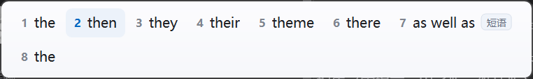
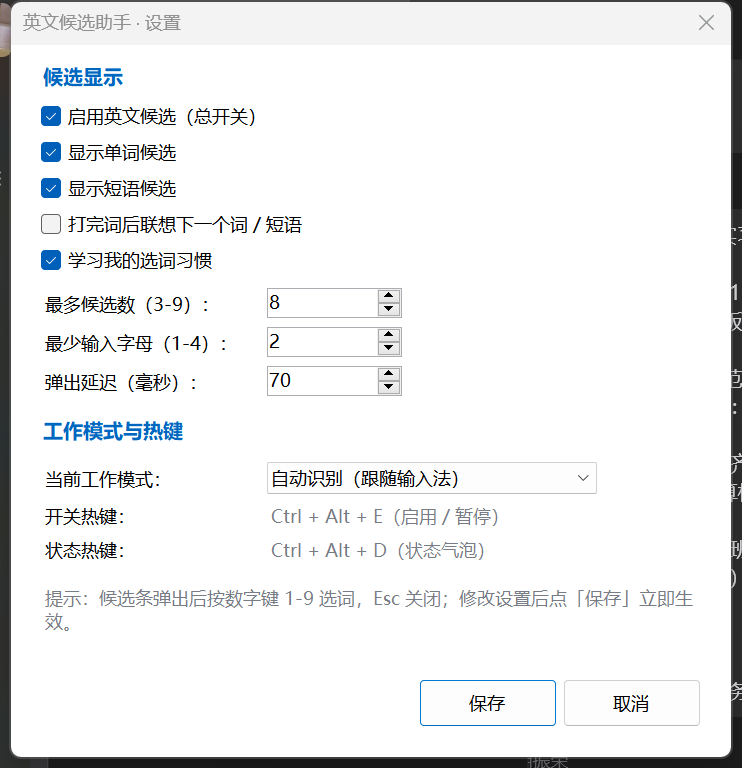

# 英文候选助手（EngCand）

> **Windows 英文输入候选助手** —— 给「中文输入法用户」的英文单词 / 短语补全工具。
> 在搜狗拼音等中文输入法切到**英文模式**后打字，光标附近会弹出英文候选，按 `1-9` 直接选词。

<p>
  
  
  
  
</p>



## 这是什么 / 解决什么问题

很多中文用户日常使用搜狗拼音等中文输入法，偶尔需要打英文：**中文模式下打字有候选，切到英文模式就只能硬拼**，拼错再去搜，体验很割裂。

**英文候选助手**常驻系统托盘，做三件事：

- 监听全局键盘输入，识别你正在**英文模式**下输入英文单词；
- 从本地词典（4.8 万单词 + 近 2 千常用短语 + 5 万词对联想）做**前缀补全**，在光标附近弹出候选；
- 选中后自动「退格 + 注入」替换掉已输入的前缀。

它**不是**一个新的输入法：不抢输入法、不改变中英文状态、不联网。

```
输入 tha    →  1.thank   2.that   3.than   4.thanks   5.thank you ...
输入 wonder →  1.wonderful  2.wonder  3.wondering ...
输入 thank  + 空格（可选）→  联想：you / you very much / god ...
```



## 特性

| 特性 | 说明 |
| --- | --- |
| 英文单词补全 | 约 **48,000** 个英文单词，前缀匹配、按词频排序 |
| 短语候选 | 约 **1,900** 条常用短语，如 `thank you`、`as soon as possible` |
| 下一词联想（可选） | 打完一个词后按上下文联想下一个词/短语（默认关闭） |
| 中英模式识别 | 通过搜狗拼音的组词候选窗口 + `Shift` 点按跟踪判断，**中文组词时绝不弹窗** |
| 不抢焦点 | 候选条是 `WS_EX_NOACTIVATE` 置顶窗口，不会打断打字 |
| 选词注入 | 数字键 `1-9` 选词，Esc 关闭；「退格 + SendInput」替换前缀 |
| 托盘常驻 | 启用/暂停、工作模式、设置、状态、日志、退出；`Ctrl+Alt+E` 开关 |
| 用户学习 | 记录你的选词，动态提升常用词排序（本地保存） |
| 完全离线 | 无网络请求、无遥测，配置在 `%APPDATA%\EngCand\` |

## 工作原理（简述）

1. `WH_KEYBOARD_LL` 全局键盘钩子 → 维护当前英文单词缓冲（`WordBuffer`）；
2. 判断当前是否处于英文模式：
   - 轮询系统顶层窗口，检测搜狗拼音的 **`SoPY_Comp` 组词窗口**是否可见（中文组词中 → 抑制候选）；
   - 同时跟踪 `Shift` 点按（搜狗中英文切换键）作为模式状态；
3. 英文模式下按前缀查询本地 Trie 词典（`CandidateEngine`），弹出无焦点候选条；
4. 用户按数字键 → `TextInjector` 用 `SendInput` 退格并注入完整单词/短语。

**候选位置（重要）**：标准输入控件（记事本/Word/WinForms 等）通过 `GetGUIThreadInfo` 拿到真实文本插入符，候选条精确贴光标；微信/QQ/Chrome 等**自绘界面**系统不提供插入符坐标，退化为「该应用最近一次搜狗中文候选条的位置」→ 鼠标附近 → 窗口左下输入区，保证不会乱跑到屏幕角落（v1.0.1 修复）。

## 系统要求

| 项目 | 要求 |
| --- | --- |
| 操作系统 | Windows 10 1809+ / Windows 11，x64 |
| 运行时 | **.NET 10 Desktop Runtime**（程序为框架依赖发布；本机装了 .NET 10 SDK 即可） |
| 输入法 | 搜狗拼音（中文模式识别按搜狗实现；其它输入法可用托盘「强制英文」模式） |
| 权限 | 普通用户，**无需管理员权限** |
| 网络 | 运行不需要联网 |

> ⚠️ 以管理员权限运行的窗口（任务管理器、部分安装程序）收不到普通权限程序的键盘钩子（Windows UIPI 限制），这是预期行为。

## 快速开始

### 方式 A：下载免构建包（推荐普通用户）

在 **[docs/DOWNLOAD.md](docs/DOWNLOAD.md)** 查看下载方式：GitHub Actions 云端构建产物（推荐）或本目录 base64 分片还原的官方包。

1. 解压 → 双击 `启动.bat`（托盘出现 "En" 图标，可能藏在 `^` 里）；
2. （可选）右键 `install.ps1` → 用 PowerShell 运行，创建桌面快捷方式；加 `-AutoStart` 开机自启。

### 方式 B：从源码构建

需要 **.NET 10 SDK**，然后：

```powershell
# 1) 准备词典数据（一次性；需要联网下载第三方语料，见下方「数据与许可」）
python tools/fetch_raw.py
python tools/build_lexicon.py
python tools/check_lexicon.py --strict

# 2) 构建（输出 dist\app）
powershell -NoProfile -ExecutionPolicy Bypass -File .\build.ps1

# 3) 启动
.\dist\app\EngCand.exe
# 或双击 启动.bat
```

构建完成后可自检词典加载：

```powershell
.\dist\app\EngCand.exe --selftest
# 会在 exe 同目录与 %APPDATA%\EngCand\ 下写 selftest.log，末尾 RESULT: PASS
```

> 构建脚本会自动定位 `dotnet`（找不到时回退 `C:\Program Files\dotnet\dotnet.exe`），并把构建缓存放在仓库内 `.build\`，不污染用户目录。
> 本机离线环境不能使用 `PublishSingleFile`（需要 NuGet 拉包），因此 dist 是多文件目录 + `data\`。

## 使用说明

### 基本用法

1. 托盘图标存在（程序在运行）；
2. 搜狗按 `Shift` 切到**英文模式**；
3. 输入英文字母（默认 ≥2 个）→ 光标附近弹出候选；
4. 按 `1-9` 选词（或鼠标点击候选）→ 自动替换已输入前缀；`Esc` 关闭候选。

### 快捷键

| 快捷键 | 作用 |
| --- | --- |
| `1-9` | 候选可见时选词 |
| `Esc` | 关闭候选 |
| `Ctrl+Alt+E` | 启用 / 暂停英文候选 |
| `Ctrl+Alt+D` | 状态提示气泡（当前模式 / 词典条数） |

### 托盘菜单

启用/暂停 · 工作模式（自动识别 / 强制英文 / 强制中文）· 设置… · 状态信息 · 打开日志 · 退出。

### 配置文件与日志

`%APPDATA%\EngCand\`

| 文件 | 说明 |
| --- | --- |
| `config.json` | 用户设置（删除即恢复默认） |
| `learning.json` | 选词学习记录 |
| `engcand.log` | 运行日志（排查用） |

详细图文说明见 [docs/使用说明.html](docs/使用说明.html)（浏览器打开）。

## 数据与许可（重要）

仓库**不包含**词典数据文件（`data/*.tsv`）和第三方语料（`data/raw/*`），只包含可复现的数据管线：

```powershell
python tools/fetch_raw.py      # 下载到 data/raw/（按 data/raw/README.md 列出的公开来源）
python tools/build_lexicon.py  # 生成 data/words.tsv、phrases.tsv、word_bigrams.tsv
python tools/check_lexicon.py --strict
```

数据来源与许可证（详见 [data/raw/README.md](data/raw/README.md)）：

| 来源 | 用途 | 许可证 |
| --- | --- | --- |
| [FrequencyWords](https://github.com/hermitdave/FrequencyWords) `en_50k`（OpenSubtitles 2018） | 主词表与词频 | CC BY-SA 4.0 |
| [Norvig Google Web 1T n-grams](https://www.norvig.com/ngrams/) `count_1w` / `count_2w` | 词对/短语校验 | 公开数据集 |
| [first20hours/google-10000-english](https://github.com/first20hours/google-10000-english) | 排序交叉校验 | 见仓库 |
| [2ndLA/english-phrases](https://github.com/2ndLA/english-phrases) 等 | 常用短语搭配 | CC BY-SA 4.0 / 见仓库 |
| [baiango/english_idioms](https://github.com/baiango/english_idioms) | 习语 | Unlicense |

所以：**本仓库代码为 MIT；由上述语料生成的词典数据遵循其上游许可证（CC BY-SA 4.0 等），不随本仓库 MIT 授权**。如果你重新分发构建产物，请保留来源与许可证说明。

## 已知限制（诚实说明）

- **仅 Windows**：依赖 Win32 键盘钩子、`SendInput`、`GetGUIThreadInfo`。
- **中文模式识别针对搜狗拼音**：通过其组词窗口类名识别；其它输入法请用托盘「强制英文」。
- **自绘界面没有文本光标**：微信/QQ/浏览器等拿不到插入符坐标，候选位置为「搜狗候选条位置/鼠标/窗口左下」的近似值。要做到 100% 贴光标需要接入 TSF/UIA（后续可做）。
- **管理员窗口无效**：Windows UIPI 限制，本程序不请求管理员权限。
- **全屏独占游戏 / 部分远程桌面**可能收不到全局钩子。
- **个别编辑器不兼容注入**：选词依赖「退格 + Unicode 注入」，游戏/远程桌面/带输入拦截的软件可能异常。
- `Enter`/`空格`/标点会结束当前词；`ddsdad` 这种非单词前缀不会弹候选（词典前缀匹配，不是任意字母联想）。

## 项目结构

```
engcand/
├─ src/EngCand/            # C# .NET 10 WinForms 源码
│  ├─ Program.cs           # 托盘 + 钩子 + 模式判断 + 选词注入主流程
│  ├─ Contracts.cs         # 模块契约
│  ├─ Core/                # 键盘钩子 / 词缓冲 / 搜狗状态 / 文本注入 / 词典 / 候选引擎 / 学习
│  ├─ UI/                  # 候选条 / 光标定位 / 托盘 / 设置 / 热键 / 主题
│  └─ SelfTest.cs, TestModes.cs   # --selftest、开发诊断模式
├─ tools/                  # Python 数据管线（下载 → 生成词典 → 校验）
├─ data/                   # 词典数据（生成物，gitignored）；data/raw/README.md 记录来源
├─ docs/                   # 使用说明.html + 截图
├─ tests/wordbuf/          # 核心逻辑单元测试（.NET 控制台工程）
├─ build.ps1               # 一键构建（dotnet publish → dist\app + 拷贝词典）
├─ install.ps1 / uninstall.ps1 / 启动.bat
└─ README.md / LICENSE
```

## 开发与测试

```powershell
# 单元测试（WordBuffer / 键盘钩子 / 文本注入 / 搜狗状态）
dotnet run --project tests/wordbuf/EngCandCoreTests.csproj

# 词典自检（无需界面）
.\dist\app\EngCand.exe --selftest

# 开发诊断模式（会短暂操作前台窗口/键盘，仅供调试）
.\dist\app\EngCand.exe --detect-test   # 验证搜狗中英文模式识别
.\dist\app\EngCand.exe --caret-test    # 验证光标定位/兜底位置
```

> 说明：GUI 端到端测试脚本与构建机环境相关，未纳入仓库。

## 常见问题

- **打了英文不弹**：确认输入法是英文模式、程序已启用（`Ctrl+Alt+E`）、输入的是真实单词前缀（如 `hel`、`thank`）；管理员窗口无效。
- **候选位置奇怪**：微信/浏览器属自绘界面，见上文「已知限制」；先在该应用里用中文打几个字，让程序记住搜狗候选条位置，再用英文会更准。
- **提示"已经在运行"**：单实例程序，看托盘图标；需要重启先在托盘退出。
- 更多见 [docs/使用说明.html](docs/使用说明.html)。

## 免责声明

本项目是个人开源工具，**与搜狗、腾讯、Microsoft 无关**；不修改/拦截输入法程序，仅读取系统窗口与键盘事件。使用本工具造成的任何问题由使用者自行承担。

## License

代码：[MIT](LICENSE)。
词典数据的许可证随上游语料（见[数据与许可](#数据与许可重要)）。

---

### English summary

**EngCand** is a Windows tray utility that shows English word/phrase suggestions while typing in **English mode** with a Chinese IME (tuned for Sogou Pinyin). It's not an IME: it uses a global keyboard hook, local prefix-completion dictionary, and a non-activating candidate bar; selecting inserts the completion via `SendInput`. MIT licensed code; dictionary data derives from CC BY-SA sources and is generated locally by the included pipeline.
